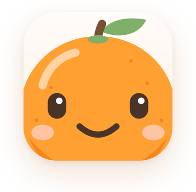

## About Me

I'm a second-year Ph.D. student in the Department of Electrical Engineering and Computer Science (EECS) at MIT, advised by Prof. [Caroline Uhler](https://www.carolineuhler.com/). I graduated from [Williams College](https://williams.edu/) in 2024 with a B.A. in Computer Science and Economics.

I'm broadly interested in generative AI and causal inference. I enjoy developing methods grounded in theory. 

From June to September 2026, I was a research intern at Apple, working on a research project on post-training vision-language models.

I wrote my undergraduate [thesis](https://librarysearch.williams.edu/discovery/delivery/01WIL_INST:01WIL_SPECIAL/12406122570002786) with Prof. [Rohit Bhattacharya](https://rohit-bhattacharya.com/) on developing novel causal inference methods in network data where observations are not independent and identically distributed.

In summer 2023, I participated in the [SMALL REU](https://math.williams.edu/small/) program and collaborated with [CSAFE](https://forensicstats.org/) to improve the robustness of ML models for shoeprint matching in forensic applications.

## News

#### See more details [here](./news_detail).
- **[Jan. 2025]** Our paper on causal effect estimation in social networks got accepted by Causal Learning and Reasoning (CLeaR) 2025! 🎉
- **[Jun. 2024]** I graduated from Williams College and am honored to receive _Valedictorian_, _Summa Cum Laude_, and _Highest Honors in Computer Science_ awards!
- **[May 2024]** I gave an oral presentation at the American Causal Inference Conference (ACIC) 2024, Seattle, WA. See slides [here](./news_detail/#acic-2024-oral).
- **[May 2024]** I successfully defended my thesis before the Computer Science department at Williams College! See details [here](./news_detail/#thesis-talk).
- **[Nov. 2023]** My collaborators and I submitted a research paper on ML robustness to _Journal of the Royal Statistical Society Series C: Applied Statistics_. Preprint can be accessed [here](https://arxiv.org/pdf/2405.14878).
- **[Aug. 2023]** During SMALL REU program, my collaborators and I published an interactive web App called "SoleMate: An End-To-End System for Forensic Shoeprint Matching". Try [here](https://solemate.streamlit.app/)!




## Side Projects
{: style="margin-top:28px;"}

  
  
<a href="https://yufengwu.dev/calmera/"><strong>Calmera</strong></a>: an AI calorie and macro tracker for iPhone, powered by your own ChatGPT or Claude.

